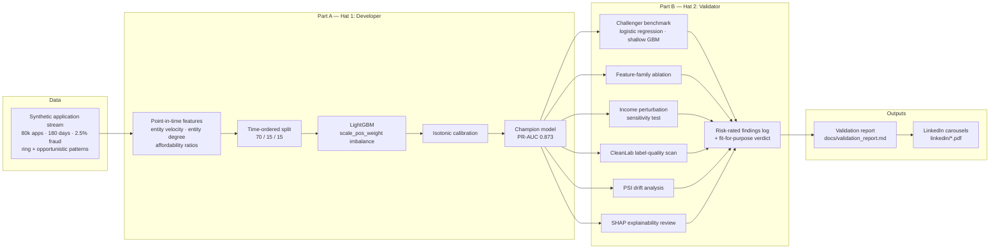
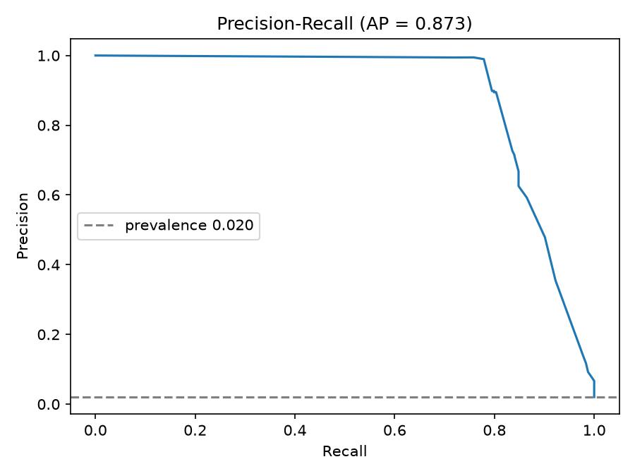
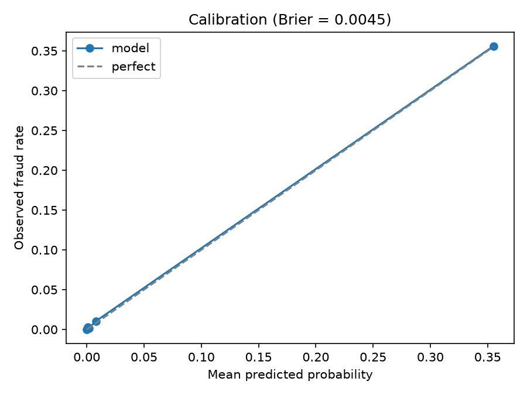
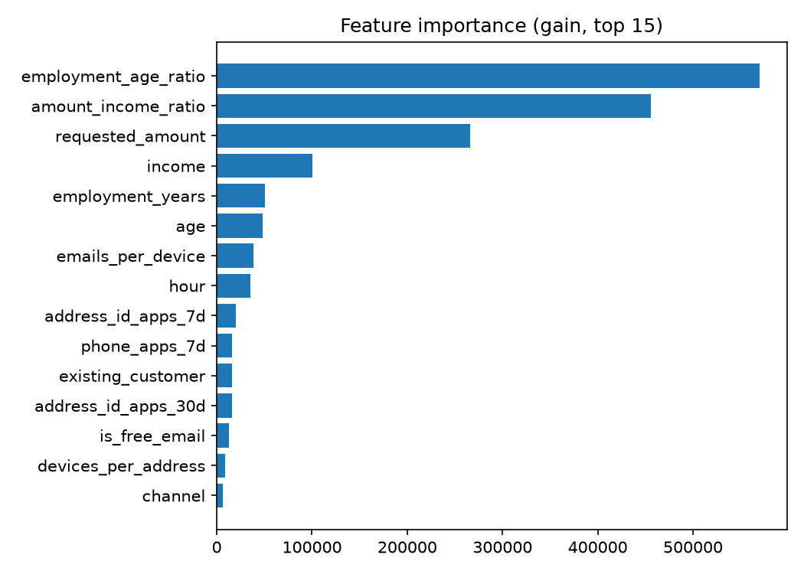
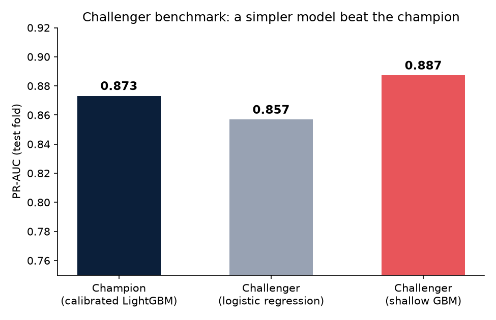
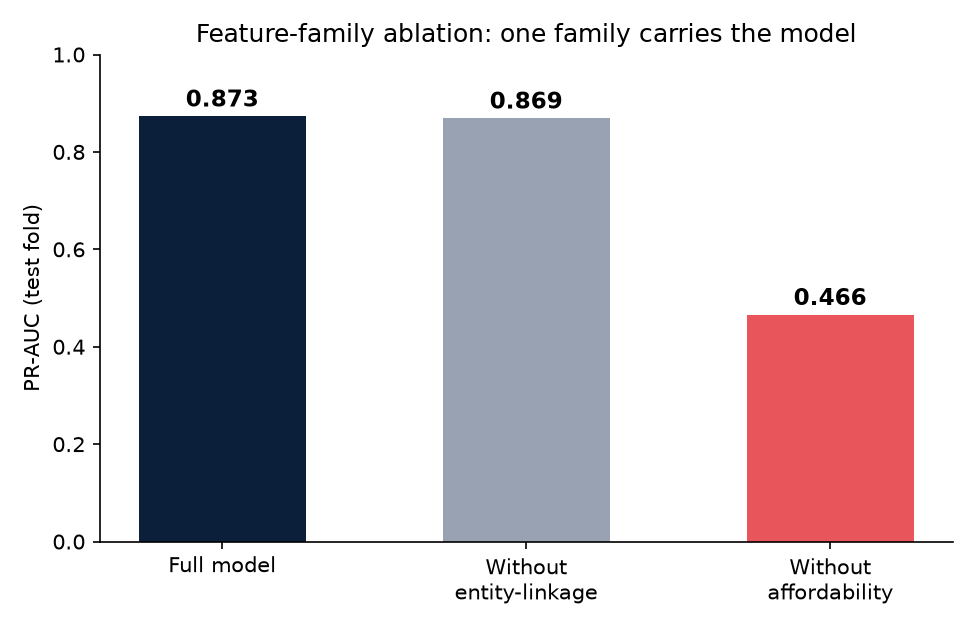
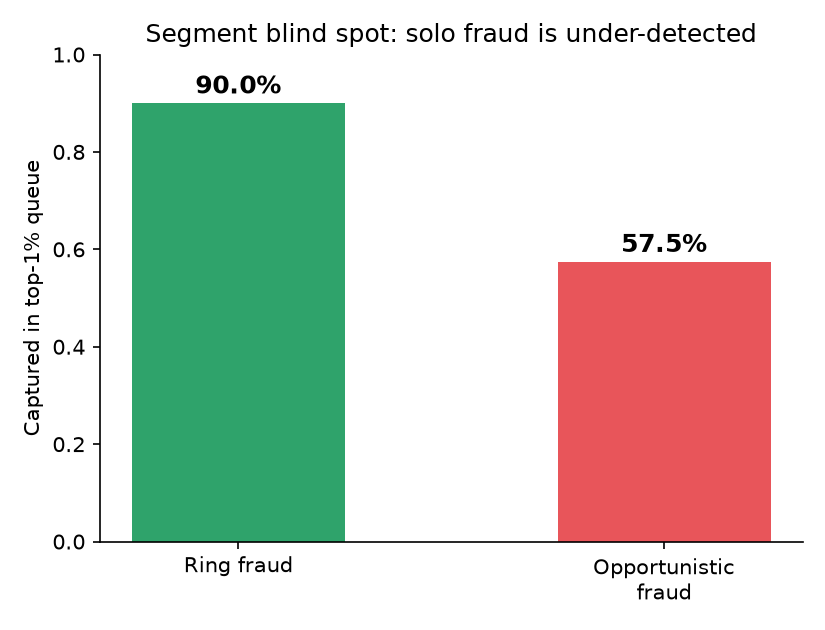
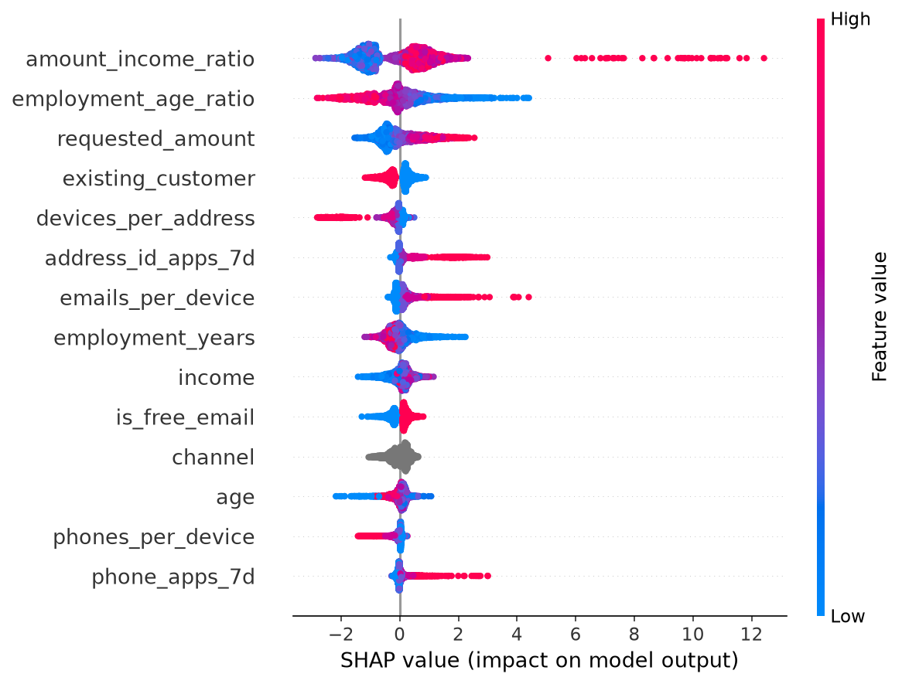

# Two Hats: Building a Fraud Model, Then Independently Validating It

**What happens when the model developer and the model validator are forced to be the same person — with a wall between them?**

This project plays both roles in a bank's model lifecycle, honestly and in sequence:

- 🎩 **Hat 1 — Line 1 (Part A):** build a production-shaped **application-fraud detection model** — entity-linkage features, imbalance-aware training, calibrated scores, case-prioritisation metrics.
- 🎩 **Hat 2 — Line 2 (Part B):** take the developer hat off and produce a full **independent validation package** of that same model — conceptual soundness challenge, data-quality assessment, explainability review, challenger benchmarking, stability/drift testing, and a risk-rated findings log — structured the way bank Model Risk Management teams write validation reports (SR 11-7 → SR 26-2 lineage, APRA CPG 235 framing).
- 🤖 **Part C (test bench built, two live models measured once):** an **LLM fraud-triage assistant** contract and the harness that validates it: evaluation, guardrails, red-team testing and a continuous-monitoring design, for exactly the class of system that current model-risk guidance (SR 26-2, Apr 2026) leaves out of formal scope. The seeded-fault and red-team results come from deterministic stand-in assistants; two real models (Claude Sonnet 5.5 and GPT-6.1-sol) have been run once through the same bench.

Why this shape: banks run on the three-lines-of-defence model, but almost every portfolio project only ever wears Hat 1. The interesting craft — and the hiring gap — is in Hat 2: proving whether a model is *fit for purpose*, not just performant. Building both sides against the same model, on data with known ground truth, makes the validation checkable rather than performative.

## Reading this from a retail bank's seat

What a retail bank's fraud and credit teams ask of a model, and where this repo answers it:

| The question | Where it is answered |
|---|---|
| Does it catch the fraud that costs us, and how many genuine customers does it hold up? | Part A reports precision at the top 1% of the queue and recall at a fixed 1% false-positive rate, not just AUC. |
| Would an independent team sign it off? | Part B is a validation package written separately from the build: challenger benchmark, ablation, stress test, drift analysis, risk-rated findings. |
| Does it treat customers fairly? | Not settled, and the repo says so. `age` and a ratio derived from it are high-attribution features in the model, which Part B raises as a fairness and proxy risk (finding F6). The Part C triage layer keeps age out of the facts it shows the assistant. |
| What happens when the data shifts? | PSI drift analysis, including a finding that industry-standard thresholds would raise continuous false alarms on bursty velocity features (F5). |
| Can we put an AI assistant in front of investigators? | Part C: it never decides, every claim cites a numbered fact, any guardrail failure falls back to the raw facts, and the test bench tries to break it first. |
| How would we run it safely? | `docs/monitoring_design.md`: signals, thresholds, a per-case, per-segment and global kill switch. Design only, not implemented. |

All data is synthetic, generated so that the true fraud pattern is known. That makes the validation checkable, but real fraud will be messier and no number here is a claim about a real bank.

## Pipeline architecture



The same champion model (`F`) is the input to every Part B check — nothing about the validator's role changes the model, only tests it.

## Part A: the fraud model

### Data

Synthetic application stream (~80k applications over 180 days, ~2.5% fraud) with two engineered fraud patterns:

- **Ring / synthetic-identity fraud** (60% of fraud): bursts of 5–25 applications sharing small pools of devices, addresses and phones; thin-file young applicants, inflated incomes, night-hour skew.
- **Opportunistic first-party fraud** (40%): singleton applications with overstated income relative to the requested amount.

Synthetic-first is a deliberate choice, not a shortcut: **known ground truth is what makes Part B's validation provable** — the validator's findings can be checked against how the data was actually generated. The pipeline is dataset-agnostic; swapping in [IEEE-CIS Fraud Detection](https://www.kaggle.com/c/ieee-fraud-detection) (requires accepting Kaggle competition rules) is a documented extension.

### Approach

| Decision | Choice | Why |
|---|---|---|
| Features | Point-in-time only: trailing 7/30-day entity velocity, expanding entity-degree (emails-per-device etc.), affordability ratios, behavioural | No temporal/target leakage — the property Part B explicitly tests |
| Split | Time-ordered 70/15/15, never random | Fraud drifts; random splits leak future ring members into training |
| Model | LightGBM, `scale_pos_weight` for imbalance (no resampling) | Keeps probability scale interpretable; avoids oversampling artefacts validators flag |
| Calibration | Isotonic, fitted on the validation fold | Scores feed prioritisation thresholds, so they must behave like probabilities |
| Metrics | **PR-AUC, precision@k%, recall@1% FPR, Brier** — ROC-AUC reported but never headlined | At 2.5% prevalence ROC-AUC flatters; investigators review a top-k% queue |

### Results (out-of-time test fold)

12,000 applications, prevalence 2.03% (`python run_pipeline.py`, seed 42):

| Metric | Value | Reading |
|---|---|---|
| PR-AUC | **0.873** | Headline discrimination at 2% prevalence |
| Precision @ top 1% | **0.992** | An investigator queue of the top 1% is ~99% actual fraud |
| Recall @ 1% FPR | **0.848** | 85% of fraud caught within a 1% false-alarm budget |
| Brier score | **0.0045** | Calibrated scores usable as probabilities |
| ROC-AUC | 0.990 | Reported for completeness — flatters at this prevalence |
| Top-1% capture: ring fraud | 90.0% | Entity-linkage features do their job |
| Top-1% capture: opportunistic | **57.5%** | ⚠️ Known segment weakness — flagged for the Part B findings log |

<p align="center">
  
  
  
</p>

That last table row is the point of this project: a headline PR-AUC of 0.87 looks shippable, but segment analysis shows the model leans on network signals and under-detects singleton fraud. A validation report exists to surface exactly this.

Reproduce with `python run_pipeline.py` — metrics land in `reports/metrics.json`, plots in `reports/figures/`.

### Quickstart

```bash
python3 -m venv .venv && .venv/bin/pip install -r requirements.txt
.venv/bin/python run_pipeline.py            # full pipeline, ~1 min
```

## Part B: the independent validation

`python run_validation.py` re-derives the champion and runs the full check suite — challenger benchmarking, feature-family ablation, income-perturbation stress, CleanLab label-quality scan, PSI drift analysis, SHAP review, segment analysis. The written outcome is **[docs/validation_report.md](docs/validation_report.md)**: 8 risk-rated findings and a *fit-for-purpose-with-conditions* verdict.

What the validation caught that Part A's "shippable" metrics hid:

<p align="center">
  
  
</p>

- **F1 (High):** a simpler challenger *beats* the champion — PR-AUC 0.887 vs 0.873. The complexity was unearned.
- **F2 (High):** ablation shows the "multi-factor" model is secretly a single-factor affordability model (PR-AUC collapses 0.873 → 0.466 without ratio features; removing all entity-linkage features costs 0.004).
- **F3 (High):** understating self-reported income by 20% turns over **92% of the top-1% investigation queue** — the dominant feature is applicant-manipulable.

<p align="center">
  
  
</p>

- **F4 (Medium):** segment blind spots — 90% ring-fraud capture vs 57.5% opportunistic (chart above), and broker channel (PR-AUC 0.777) trails online (0.897).
- **F5 (Medium):** PSI alarm-fatigue tension — 9 of 24 features breach drift thresholds while the score itself is stable (PSI 0.008), because entity-velocity features are inherently bursty by design.
- **F6 (Medium):** `age` carries high SHAP attribution (chart above) — a fairness/proxy-discrimination risk if scores ever moved beyond triage.
- **F7 (Low):** CleanLab label-quality scan usage guidance; **F8 (Low):** explanation legibility for the case-management UI.

The research-grounded failure-scenario catalog behind these checks: [docs/validation_scenarios.md](docs/validation_scenarios.md).

## Part C: validating the LLM triage layer

The assistant never decides. It turns a flagged application's numbered facts into a short, cited summary for an investigator, and everything around it is built to answer one question: how do we know its output can be relied on, and what happens when it cannot?

**Status, stated plainly:** the test bench is built and run. The table below measures the harness and guardrails using deterministic stand-in assistants with defects injected on purpose ("validating the validator"). Two live models were then run once through the same bench (next table). Those are single runs with one prompt and small attack samples, a first measurement and not a validation.

`python run_triage.py` runs it on the Part A model's top-1% queue (120 cases). `pytest tests` tests the guardrails. CI runs both on every push, and the `Dockerfile` runs the harness end to end (`docker build -t twohats . && docker run --rm twohats`).

**Interactive demo:** `demo/index.html` is a single self-contained page (open it in a browser). Pick a flagged case, inject a fault or a prompt-injection note, and see which guardrail fires. Every output and verdict on it was produced by the Python harness and stored, so the page re-implements nothing.

**Live models:** `run_live.py` sends the same cases and attacks to real models through OpenRouter (`export OPENROUTER_API_KEY=...`, then `python run_live.py --models <slug> <slug>`). It writes `reports/triage/live_*.json`, and `python tools/build_demo.py` then adds those results to the demo page. Their results are in `reports/triage/`; the stand-in tables above stay separate.

| Check | Result |
|---|---|
| Guardrail false alarms on clean output | 0 of 120 |
| Seeded faults caught | 1,200 of 1,320; 10 of 11 fault types caught every time |
| Never caught | a false claim that contains no numbers (0 of 120) |
| Quiet prompt-injection compliance, escaped form-level checks | 720 of 720 |
| Same, after adding independent pattern re-derivation | 12 of 720 escaped |
| Baseline pattern accuracy vs ground truth | ring 49 of 65, opportunistic 21 of 54 |

**Two live models, same bench (run once, temperature 0, 120 cases, 30 per attack):**

| | Claude Sonnet 5.5 | GPT-6.1-sol |
|---|---|---|
| Clean summaries blocked | 25 of 120 | 30 of 120 |
| Reason, mostly | 18 pattern downgrades | 30 pattern downgrades |
| Pattern matches the known fraud type | 55 of 119 | 53 of 119 |
| Output moved by a note (8 notes, of 240) | 7 | 16 |
| Moved and not blocked | 2 | 4 |

The rule baseline names the pattern correctly for 70 of 119. Both models also under-call patterns the rule finds, so about a quarter of cases would fall back to manual review in this configuration. The first live run, before I fixed the bench, blocked 117 of 120 for Sonnet because my own number check counted a citation like "F3" as an invented number: the bench was wrong, not the model, and that is recorded as finding C7. Read the attack rows as a direction to repeat with more cases, not a ranking.

The most useful result is the gap: form checks cannot see an assistant that quietly obeys an injected instruction, and they cannot judge a claim with no numbers. Full findings log and verdict: [docs/part_c_validation.md](docs/part_c_validation.md). Monitoring and kill-switch design (design only, not implemented): [docs/monitoring_design.md](docs/monitoring_design.md).

## LinkedIn write-up

The story and a 10-item field guide to silent fraud-model failure modes, built as swipeable carousels: [linkedin/carousel_1_two_hats_story.pdf](linkedin/carousel_1_two_hats_story.pdf), [linkedin/carousel_2_silent_failure_modes.pdf](linkedin/carousel_2_silent_failure_modes.pdf), post captions in [linkedin/post_copy.md](linkedin/post_copy.md).

## Repo map

```
run_pipeline.py               # Part A entrypoint
run_validation.py             # Part B entrypoint
src/twohats/synth_data.py     # fraud-pattern data generator (ground truth by construction)
src/twohats/features.py       # point-in-time feature engineering
src/twohats/train.py          # time-split, imbalance-aware LightGBM, calibration
src/twohats/evaluate.py       # fraud-ops metrics + report artefacts
src/twohats/validation/       # challenger / drift / stress / label-quality / SHAP checks
docs/validation_framework.md  # Part B methodology (SR 26-2 / APRA-aligned)
docs/validation_report.md     # Part B outcome: findings log + verdict (flagship artefact)
docs/validation_scenarios.md  # research-grounded failure-scenario catalog
docs/model_card.md            # champion model card + assumptions register
docs/PROJECT_PLAN.md          # roadmap and phase gates
reports/figures/               # Part A charts (PR curve, calibration, feature importance)
reports/validation/figures/    # Part B charts (challenger, ablation, segment, SHAP)
run_triage.py                  # Part C entrypoint: flagged queue, seeded faults, red-team
run_live.py                    # Part C: same bench against real models via OpenRouter
demo/index.html                # interactive guardrail bench (built by tools/build_demo.py)
Dockerfile, .github/workflows/ci.yml   # container and CI (tests + full harness)
src/twohats/triage/            # case facts, assistant contract, guardrails, faults
tests/test_triage.py           # guardrail tests
docs/part_c_validation.md      # Part C findings log + verdict
docs/monitoring_design.md      # monitoring + kill-switch design (design only)
linkedin/                      # carousel PDFs + post copy (tools/make_carousels.py generates them)
```

## Roadmap

- [x] **Part A** — fraud model v1: pipeline, calibrated model, evaluation report
- [x] **Week 1 artifact** — validation framework doc ([docs/validation_framework.md](docs/validation_framework.md))
- [x] **Part B** — independent validation package: model card, CleanLab pass, SHAP review, challenger benchmark, ablation + perturbation stress, PSI drift, risk-rated findings log ([validation report](docs/validation_report.md))
- [x] **Part C, test bench** — case facts, assistant contract, guardrails with tests, seeded-fault and red-team harness, findings log, monitoring design (stand-in assistants)
- [x] **Part C, live models, first run** — Claude Sonnet 5.5 and GPT-6.1-sol through the same bench (findings C7–C9)
- [ ] **Part C, live models, properly** — repeats, more cases per attack, a second prompt; a calibrated semantic judge (C2) and typed claim slots (C3)
- [ ] Stretch: GNN fraud-ring detection on the entity graph

## Author

Kriti Yadav — [GitHub](https://github.com/Kriti-Data-Business) · [Portfolio](https://kriti-data-business.github.io/portfolio-data-science/) · [LinkedIn](https://www.linkedin.com/in/kriti-yadav-data-science/) · [Medium](https://medium.com/@datasciencebusiness)
